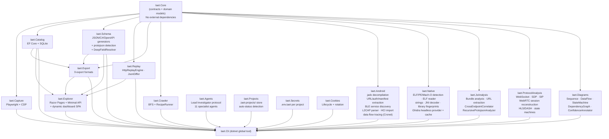
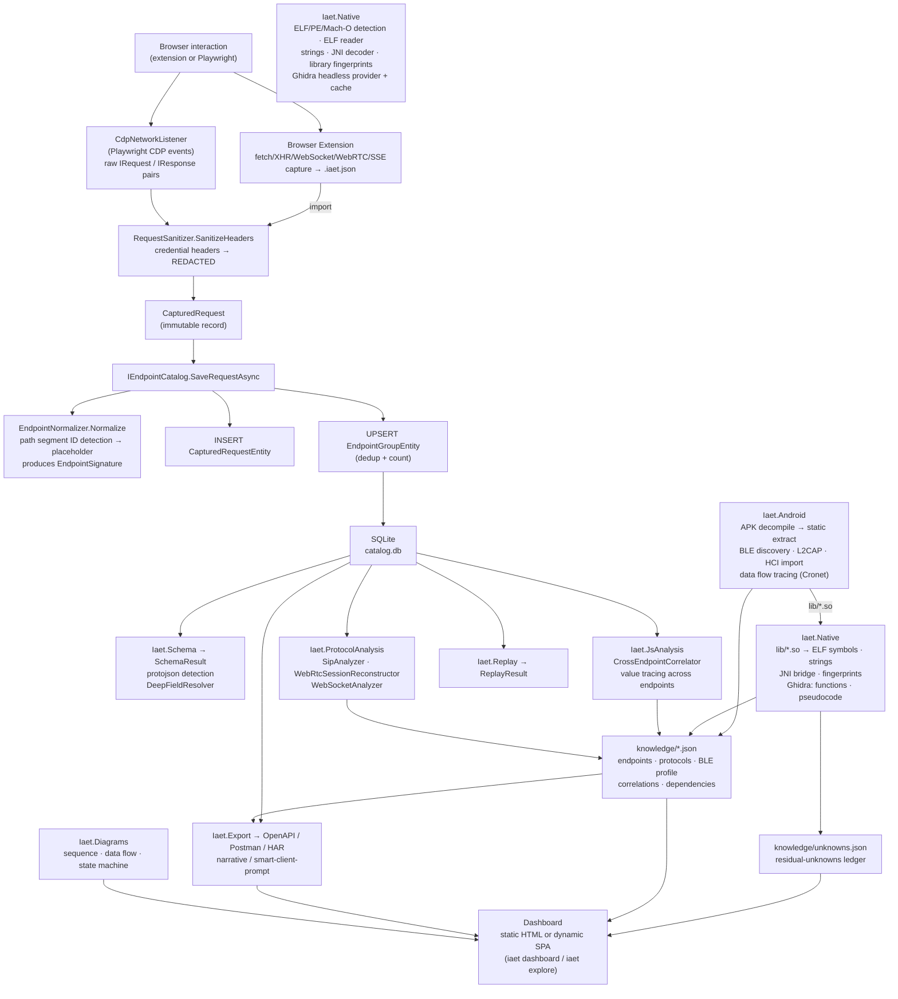

# IAET Architecture

## Assembly Dependency Diagram

## Data Flow

## Design Decisions

### Dependency inversion via Iaet.Core
All concrete assemblies depend on `Iaet.Core`, never on each other. This keeps `Iaet.Capture` and `Iaet.Catalog` independently testable and swappable. The CLI is the only composition root.

### EF Core over raw SQLite
EF Core was chosen for migration management and LINQ query composition. The tradeoff is a larger binary; the benefit is that schema evolution (adding columns, indexes) is tracked in source-controlled migration files with zero manual SQL.

### Deduplication at write time
`EndpointGroup` rows are upserted every time a request is saved rather than computed on read. This keeps `GetEndpointGroupsAsync` O(1) per group and avoids full-table scans on large sessions.

### System.CommandLine (preview)
The CLI uses the `System.CommandLine` library for structured argument parsing, typed options, and built-in `--help` generation. The `System.CommandLine.Hosting` integration is not used; instead the DI host is built once in `Program.cs` and passed into each command factory, which keeps the host lifetime aligned with the process rather than the command.

### Header sanitization as a hard invariant
`RequestSanitizer` is not configurable. Any future opt-in mechanism would require an explicit allowlist, not a blocklist, to prevent accidental credential exposure in shared capture databases.

### Playwright for capture
Playwright (Chromium via CDP) was chosen over raw proxy interception because it can capture traffic from single-page applications that make XHR/fetch calls inside complex authentication flows without requiring SSL certificate trust overrides on the host machine.

### Deep Field Resolver for protojson
Google APIs return protojson (positional JSON arrays with no field names). The Deep Field Resolver combines three strategies to infer field names: value-type heuristics, cross-endpoint correlation (shared values across responses), and ProtoFieldMapper (matching against `.proto` field names extracted from decompiled APK source).

### L2CAP parsing for non-GATT BLE
Many BLE devices use L2CAP dynamic channels instead of GATT for high-throughput data transfer. The L2CAP protocol extractor parses connection-oriented channel frames from HCI snoop logs, enabling analysis of devices that do not expose standard GATT services.

### Evidence over assertion
Borrowed from REA ("Reverse Engineer Anything"): a finding is only as good as the statement of how it was established. `Evidence` records carry an `EvidenceKind` (observation, derivation, inference, unknown), the producing provider, the artifact and its SHA-256, a location, a confidence level and explicit limitations. Questions that could not be answered become `ResidualUnknown` entries in `knowledge/unknowns.json` (merged by id, hand-resolvable) rather than disappearing from the narrative. Agents label every claim with one of the four kinds.

### Native analysis delegates to Ghidra, never reimplements it
`Iaet.Native` runs cheap static providers itself (format detection, ELF `.dynsym`/`.dynamic`, strings, JNI name decoding, library fingerprints) because they need no external tool and already answer most API-investigation questions (which hosts, which UUIDs, which Java methods cross into native code, which crypto library). Disassembly and decompilation are delegated to Ghidra's headless analyzer through a packaged post-script (`IaetGhidraExport.java`) that exports functions, callers/callees, referenced strings and pseudocode as JSON. Ghidra is bring-your-own (located via `IAET_GHIDRA_PATH`, `GHIDRA_INSTALL_DIR`, `GHIDRA_HOME` or PATH), works in a scratch project that is deleted afterwards, and never modifies the input.

### Content-addressed provider cache
Headless Ghidra runs take minutes. Results are cached under `<project>/native/work/cache/` keyed by SHA-256(binary) + operation + script version + options, so identical inputs are never re-analyzed while a rebuilt binary or a new script version always is.

### Tool providers and `iaet doctor`
External engines implement `IToolProvider` (name, capabilities, `CheckAsync`). `iaet doctor [--json]` probes them together with jadx, apktool, Java, Node, Playwright and Python and reports which IAET capabilities each unlocks, so an investigation knows up front what it can and cannot do. It is read-only and never installs anything.

### Dynamic dashboard SPA
The `iaet explore` command serves a thin SPA that reads project data live from the catalog database and `.iaet-projects/` directory, replacing the previous 430KB+ static HTML dashboard with an interactive experience that supports project selection, live refresh, and embedded Swagger UI.
